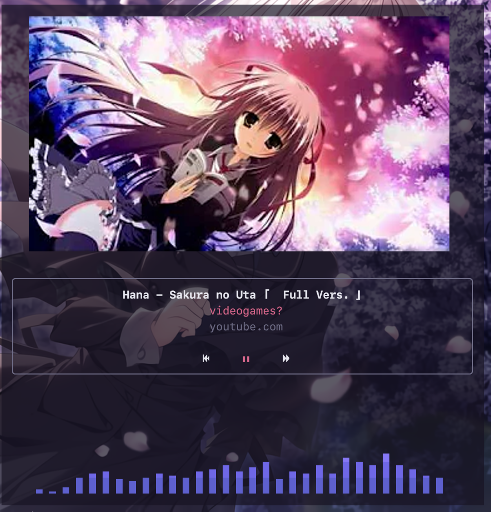
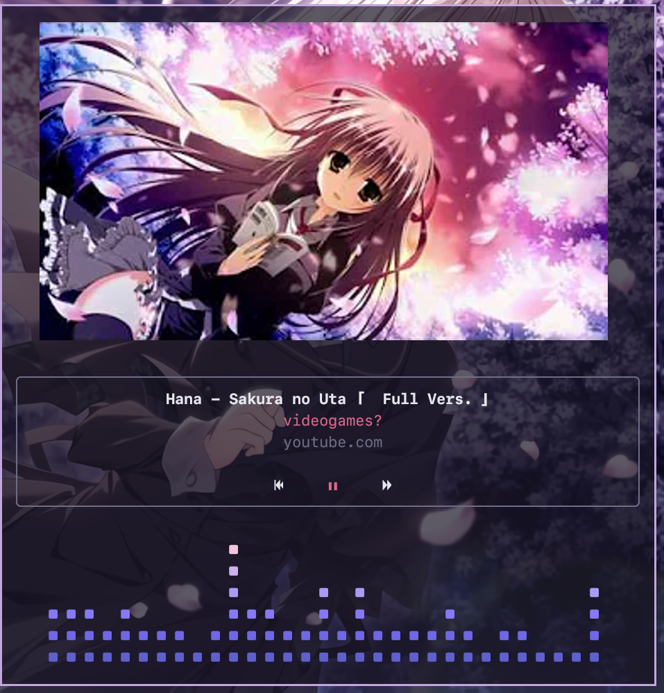
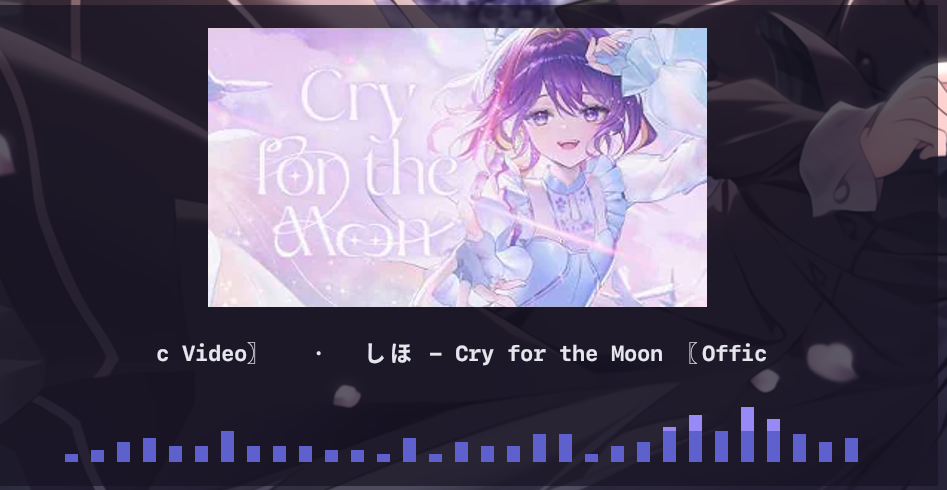

<div align="center">

# UtaTUI

**A beautiful, minimalist Now Playing dashboard for your terminal.**

Control whatever is playing on your Linux desktop — Spotify, Firefox, mpv, VLC, or any
[MPRIS](https://specifications.freedesktop.org/mpris-spec/latest/) player — from one
artwork-first screen with a live audio visualizer.

[](https://github.com/NunoiEnter/Utatui/actions/workflows/ci.yml)
[](LICENSE)


</div>

<p align="center">
  
</p>

<table align="center">
  <tr>
    <td align="center"><br><sub>Blocks visualizer style</sub></td>
    <td align="center"><br><sub>Short terminal, scrolling title</sub></td>
  </tr>
</table>

UtaTUI is **not a music player**. It is a remote control and visual companion for the
players you already use: it discovers them over D-Bus, shows what they are playing, and
draws a real-time spectrum from your system audio through [cava](https://github.com/karlstav/cava).

## Features

- **Artwork first** — album art and video thumbnails rendered with Kitty, Sixel or iTerm2
  graphics, with a Unicode half-block fallback for any terminal. YouTube videos get their
  full-resolution 1280×720 thumbnail instead of the browser's small preview.
- **Works with every MPRIS player** — automatic discovery, follows whatever is playing, and
  a compact player picker when several are open.
- **Full playback control** — play/pause, next, previous, stop and seek. Controls a player
  doesn't support are greyed out instead of failing silently.
- **Real audio visualizer** — five styles (bars, mirror, wave, blocks, minimal) driven by
  cava, with gradients, adjustable bar count, spacing, sensitivity and smoothing.
- **Live settings panel** — tweak theme, artwork, visualizer and more while you watch the
  result; save to disk with one key.
- **Adaptive theming** — nine built-in themes, plus an accent color picked automatically
  from the current artwork.
- **Fits any terminal** — from a full screen down to a tiny 26×5 corner pane, the artwork
  and visualizer stay visible; long titles scroll instead of being cut off.
- **Lightweight and event-driven** — listens to D-Bus signals instead of polling, and never
  blocks the render loop on slow players, images or audio.

## Requirements

- Linux with a D-Bus session bus (any desktop or window manager, including Niri, Hyprland,
  Sway, GNOME and KDE)
- [cava](https://github.com/karlstav/cava) for the visualizer (optional; UtaTUI runs without it)
- A terminal with true color. For full-resolution artwork, one that supports the Kitty,
  Sixel or iTerm2 graphics protocol (Kitty, Ghostty, WezTerm, foot, Konsole, …)

## Installation

### Quick install (any distro)

Static binaries for x86_64 and aarch64 run on every Linux distribution — Arch, Debian,
Ubuntu, Fedora, openSUSE, Void, Alpine and more — with no runtime dependencies:

```sh
curl -fsSL https://raw.githubusercontent.com/NunoiEnter/Utatui/main/install.sh | sh
```

This installs `utatui` to `~/.local/bin` after verifying its SHA-256 checksum. Set
`UTATUI_INSTALL_DIR` to change the location or `UTATUI_VERSION` to pin a release. You can
also download an archive by hand from the [releases page](https://github.com/NunoiEnter/Utatui/releases).

Then install cava for the visualizer, for example `sudo pacman -S cava`,
`sudo apt install cava` or `sudo dnf install cava`.

To uninstall, delete the binary: `rm ~/.local/bin/utatui`.

### Arch Linux

A [`PKGBUILD`](packaging/aur/utatui-git/PKGBUILD) is included and will be published to the
AUR as `utatui-git`. Until then, build it with `makepkg`:

```sh
git clone https://github.com/NunoiEnter/Utatui
cd Utatui/packaging/aur/utatui-git
makepkg -si
```

### Nix (flake)

Run it once without installing:

```sh
nix run github:NunoiEnter/Utatui
```

Install into your profile:

```sh
nix profile install github:NunoiEnter/Utatui
```

Or add it to a NixOS / Home Manager configuration:

```nix
{
  inputs.utatui.url = "github:NunoiEnter/Utatui";

  # then, in a module:
  environment.systemPackages = [ inputs.utatui.packages.${pkgs.system}.default ];
}
```

The Nix package puts cava on UtaTUI's `PATH` automatically.

### Cargo

```sh
cargo install --git https://github.com/NunoiEnter/Utatui
```

Install cava with your distribution's package manager to enable the visualizer.

### From source

```sh
git clone https://github.com/NunoiEnter/Utatui
cd Utatui
cargo build --release
./target/release/utatui
```

## Usage

Start something playing, then run:

```sh
utatui
```

| Option            | Description                                      |
| ----------------- | ------------------------------------------------ |
| `--config <path>` | Use a specific config file                       |
| `--list`          | Print the detected players and exit              |
| `-h`, `--help`    | Show help                                        |
| `-V`, `--version` | Show the version                                 |

### Key bindings

| Key                 | Action                      |
| ------------------- | --------------------------- |
| `space`             | Play / pause                |
| `n` / `p`           | Next / previous track       |
| `→` `l` / `←` `h`   | Seek forward / backward     |
| `s`                 | Stop                        |
| `tab`               | Open the player picker      |
| `]`                 | Switch to the next player   |
| `v`                 | Cycle the visualizer style  |
| `o` or `,`          | Open settings               |
| `?`                 | Show all key bindings       |
| `q`, `esc`, `ctrl+c`| Quit                        |

Every binding can be changed in the config file.

## Settings

Press **`o`** to open settings. Every option shows a short explanation, and changes apply
immediately. On large terminals the settings open as a side panel so you can watch the
result live; on smaller ones they take the whole screen.

| Key               | Action                                  |
| ----------------- | --------------------------------------- |
| `tab` / `shift+tab` or `1`–`6` | Switch section             |
| `↑` `↓`           | Select an option                        |
| `←` `→`           | Change the value                        |
| `enter`           | Type a value (colors, preferred player) |
| `d`               | Reset the option to its default         |
| `s`               | Save to the config file                 |
| `r`               | Revert to the last saved settings       |
| `esc`             | Close settings                          |

Sections:

- **Theme** — preset, accent from artwork, accent, text, muted text, background
- **Layout** — status bar, album line, controls, scrolling long titles, time remaining
- **Artwork** — show/hide, size, shape (original or square crop), HD YouTube thumbnails,
  position (auto, top, side), graphics protocol
- **Visualizer** — on/off, style, gradient, custom colors, height, bar count, bar width,
  spacing, silence baseline, sensitivity, frame rate, smoothing
- **Player** — follow the playing player, preferred player, seek step
- **General** — ASCII-only glyphs

Built-in themes: `lavender`, `catppuccin`, `rose-pine`, `tokyo-night`, `nord`, `gruvbox`,
`sakura`, `mono`, and `terminal` (which follows your terminal's own color scheme).

## Configuration

UtaTUI reads `$XDG_CONFIG_HOME/utatui/config.toml` (usually `~/.config/utatui/config.toml`).
Every key is optional, and unknown keys are reported as errors so typos never go unnoticed.
Start from the fully commented [`config.example.toml`](config.example.toml):

```sh
mkdir -p ~/.config/utatui
cp config.example.toml ~/.config/utatui/config.toml
```

A short example:

```toml
preferred_player = "spotify"   # prefer this player when several are playing
seek_step = 5                  # seconds

[theme]
accent = "#cba6f7"
accent_from_artwork = true

[artwork]
size = 0.5                     # fraction of the terminal height
protocol = "auto"              # auto | kitty | sixel | iterm2 | halfblocks

[visualizer]
mode = "mirror"                # bars | mirror | wave | blocks | minimal
bars = 64
colors = ["accent"]            # or a list of colors, bottom to top

[keys]
play_pause = ["space", "k"]
```

> **Note:** saving from the settings panel rewrites the file, so comments in it are not kept.

## Troubleshooting

**"&lt;player&gt; doesn't share track progress"**
The player isn't reporting track length or position over MPRIS. This is common for browser
tabs (for example YouTube in Firefox). UtaTUI shows this message rather than a made-up timer.
Dedicated players such as Spotify, mpv and VLC report full progress.

**The visualizer says "no audio"**
cava isn't installed or couldn't start. Install cava, or set `visualizer.cava_path` if it
lives outside your `PATH`. UtaTUI never presents fake data as audio: without cava it shows
a clearly labeled idle animation.

**Artwork looks blocky, or keys don't respond at startup**
Your terminal may not answer the graphics capability query. Set the protocol explicitly:

```toml
[artwork]
protocol = "kitty"   # or "sixel", "iterm2", "halfblocks"
```

**A player is missing**
Run `utatui --list` to see what UtaTUI detects. The player must expose an
`org.mpris.MediaPlayer2.*` name on the session bus (check with `playerctl -l`).
`playerctld` is deliberately ignored because it mirrors another player.

## How it works

```
src/
├── main.rs          startup, terminal lifecycle, event loop
├── app.rs           application state and event handling
├── mpris/           D-Bus discovery, player state, playback commands
├── media/           artwork loading, accent extraction, time formatting
├── visualizer/      cava process management and idle fallback
├── ui/              layout, widgets, overlays, visualizer rendering
└── config/          TOML config, key bindings, settings model and themes
```

Every source of input — D-Bus signals, cava frames, artwork downloads, image encoding and
keyboard events — runs in its own task and sends events over a single channel. The main
loop only applies those events and redraws, so a slow player, a large image or a stalled
download can never freeze the interface.

## Development

```sh
cargo run                      # run a debug build
cargo test                     # run the test suite
cargo clippy --all-targets     # lint (pedantic lints are enabled in Cargo.toml)
cargo fmt                      # format
nix develop                    # shell with cava, playerctl and the Rust toolchain
```

## Contributing

Issues and pull requests are welcome. Before opening a pull request, please make sure
`cargo fmt --check`, `cargo clippy --all-targets -- -D warnings` and `cargo test` all pass.
For larger changes, open an issue first so we can agree on the approach.

## License

UtaTUI is released under the [MIT License](LICENSE).
